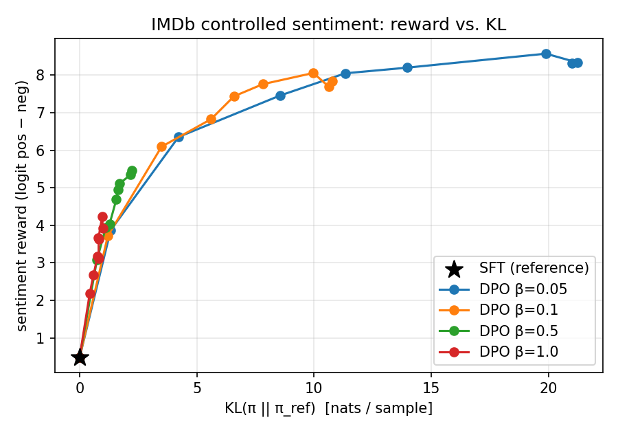
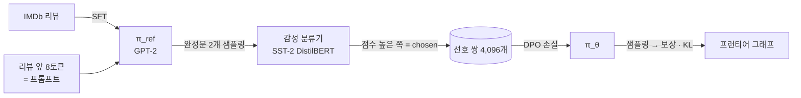

<div align="center">

# 🎯 DPO from scratch

**Direct Preference Optimization을 라이브러리 없이 직접 구현하고, 논문의 IMDb 감성 제어 실험을 재현했습니다.**

<a href="https://arxiv.org/abs/2305.18290"></a>


<a href="https://colab.research.google.com/github/dain77-d/dpo-from-scratch/blob/main/colab.ipynb"></a>

</div>

> 보상 모델도, PPO도 없이 **선호 쌍(chosen / rejected)과 손실 함수 하나**로 GPT-2를 긍정적인 리뷰를 쓰도록 정렬합니다.
> 핵심 구현은 [`dpo.py`](dpo.py) 약 40줄이 전부입니다.

---

## 📈 결과 한눈에 보기

<p align="center"></p>

GPT-2(124M), 선호 쌍 4,096개, Colab T4에서 β마다 512 스텝(평가 포함 약 5분)씩 학습했습니다.
평가는 처음 보는 프롬프트 512개로 했습니다.

| 모델 | 감성 보상 ↑ | KL(π ‖ π_ref) ↓ |
|---|---:|---:|
| SFT (기준 정책) | 0.49 | 0 |
| DPO β = 1.0 | 3.92 | 0.99 |
| DPO β = 0.5 | 5.45 | 2.21 |
| DPO β = 0.1 | 7.84 | 10.80 |
| DPO β = 0.05 | **8.31** | 21.00 |

**읽는 법**
- 모든 β에서 보상이 SFT보다 크게 오릅니다. 선호 쌍만으로 정책이 "긍정적인 글" 쪽으로 이동했습니다.
- **β는 기준 정책에 얼마나 붙어 있을지 정하는 끈**입니다. β가 크면 KL을 작게 유지하는 대신 보상이 덜 오르고, β가 작으면 보상은 높지만 기준에서 멀리 벗어납니다. 논문 식에서 β가 KL 제약의 계수라는 것을 그대로 확인할 수 있습니다.
- β = 0.05는 KL 14 이후 보상이 8 근처에서 포화되는데 KL만 계속 커집니다. 더 벗어나 봐야 얻는 게 없는 구간입니다.

## ✍️ 생성 예시 (SFT → DPO β = 0.1)

| 프롬프트 | SFT | DPO |
|---|---|---|
| *Homecoming; what a HUGE disappointment!!* | Show all wrong. This movie sucked. The plot lacked obvious excitement… | This small gem adds a great new dimension of character to his life. I highly recommend it to all!… |
| *My ratings: Acting - 3/10* | Poor storyline with the trailer begging to be killed… | Granny Smith is an outstanding actress and many people loved her performance… |
| *I'm not sure as to call this* | film a sincere classic, but I find it to not be that great… | movie notable for it's superb collage of 19th century pictures and original music… |

부정적으로 시작한 프롬프트도 긍정으로 틀어서 이어 씁니다. 모든 β의 예시는 [`results/gpu/samples.md`](results/gpu/samples.md)에 있습니다.

---

## 🧠 DPO 한 줄 요약

RLHF는 ① 보상 모델 학습 → ② PPO로 정책 최적화라는 두 단계를 거칩니다.
DPO는 KL 제약이 걸린 보상 최대화 문제의 **최적해를 닫힌 형태로 풀어서**, 보상을 정책과 기준 모델의 로그 확률 비로 바꿔 씁니다.
그러면 보상 모델 없이 선호 쌍에 대한 **이진 분류 손실** 하나만 최소화하면 됩니다.

$$\mathcal{L}_\text{DPO} = -\log\sigma\Big(\underbrace{\beta\log\frac{\pi_\theta(y_w|x)}{\pi_\text{ref}(y_w|x)}}_{\text{chosen의 암묵적 보상}} - \underbrace{\beta\log\frac{\pi_\theta(y_l|x)}{\pi_\text{ref}(y_l|x)}}_{\text{rejected의 암묵적 보상}}\Big)$$

```python
def dpo_loss(pi_chosen, pi_rejected, ref_chosen, ref_rejected, beta):
    r_chosen = beta * (pi_chosen - ref_chosen)
    r_rejected = beta * (pi_rejected - ref_rejected)
    return -F.logsigmoid(r_chosen - r_rejected).mean()
```

## 🔬 실험 파이프라인 (논문 6.1절 축소판)



| 항목 | 설정 |
|---|---|
| 정책 | `gpt2` (CPU 실행은 `distilgpt2`) |
| 보상 (평가용 정답) | `distilbert-base-uncased-finetuned-sst-2-english`의 logit(긍정) − logit(부정) |
| KL 추정 | 정책 샘플 y에 대해 log π(y) − log π_ref(y)의 평균 |
| 학습 | AdamW, lr 1e-5, batch 16, 2 epoch, β ∈ {0.05, 0.1, 0.5, 1.0} |

## 🐛 구현하면서 잡은 함정들

- **dropout을 켜면 0 스텝부터 π ≠ π_ref가 됩니다.** 정책과 기준 모델이 같으면 손실은 정확히 log 2 = 0.693이어야 하는데, 시험 실행에서 0.79가 나와서 발견했습니다. 정책을 `eval()` 모드로 둔 채 학습하도록 고쳤습니다.
- **KL 추정에는 순수 샘플링이 필요합니다.** transformers의 기본 생성 설정은 `top_k=50`이라 정책 분포에서 샘플링한 것이 아닙니다. `top_k=0`으로 둡니다.
- **응답 토큰만 로그 확률에 넣습니다.** 프롬프트와 패딩은 마스크로 뺍니다. [`test_dpo.py`](test_dpo.py)에서 검증합니다.
- π_ref의 로그 확률은 학습 중 변하지 않으므로 처음에 한 번만 계산해 둡니다.

## 🚀 실행

```bash
pip install -r requirements.txt
python test_dpo.py        # 손실·마스킹 단위 테스트
python run.py --quick     # 작은 규모로 끝까지 한 번
python run.py             # 본 실행 (GPU가 있으면 위 표의 설정, 없으면 CPU용 축소 설정)
```

GPU가 없다면 상단의 **Open in Colab** 배지를 누르고, 런타임을 T4 GPU로 바꾼 뒤 모두 실행하면 됩니다(약 25분).

```
dpo.py          DPO 손실, 응답 로그 확률, 패딩
run.py          SFT → 선호 쌍 생성 → DPO(β sweep) → 평가 → 그래프
test_dpo.py     단위 테스트
colab.ipynb     Colab 실행용 노트북
results/gpu/    metrics.json · frontier.png · samples.md
```

## 📚 참고

- Rafailov et al., *Direct Preference Optimization: Your Language Model is Secretly a Reward Model*, NeurIPS 2023. [arXiv 2305.18290](https://arxiv.org/abs/2305.18290)
- 논문 정리 노트: [ai-study-log / DPO](https://github.com/dain77-d/ai-study-log/blob/main/papers/2026-11-11.md)
